# VoiceMeeter Potato — Setup and Training SOP

<!-- README-NAV:START (generated by tools/make_readme_nav.py) -->
<p align="center">
  <a href="https://juniorduc44.github.io/voicemeeter-potato-tutorial/">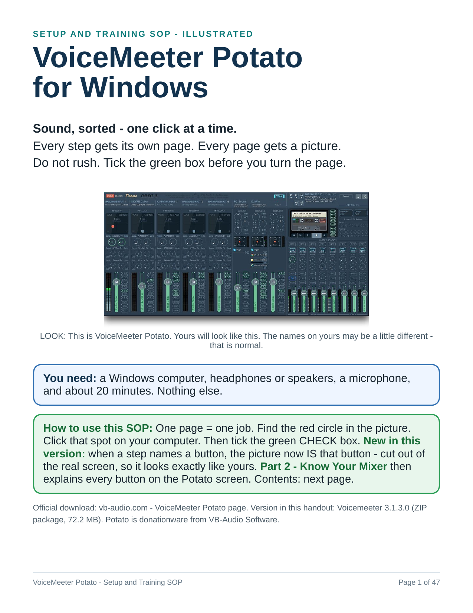</a>
</p>

<h2 align="center"><a href="https://juniorduc44.github.io/voicemeeter-potato-tutorial/">📖 Click Here to Flip Through</a></h2>
<p align="center"><sub>Opens the interactive flipbook: turn the pages right there with the big arrows, your ← → keys or a swipe. Nothing to download.</sub></p>

<h3 align="center">Learn VoiceMeeter Potato on Windows - one click at a time.</h3>
<p align="center">47 illustrated pages · real screenshots · every button explained · nothing to install to read it</p>

<p align="center">
  <a href="https://juniorduc44.github.io/voicemeeter-potato-tutorial/"><b>📖 Open the interactive flipbook</b></a> &nbsp;·&nbsp;
  <a href="handout/voicemeeter-potato-sop.pdf"><b>⬇️ Download the PDF</b></a> &nbsp;·&nbsp;
  <a href="#browse-every-page">🖼️ Browse every page below</a>
</p>

> **New here?** Read page 3 (*the one idea*), then do Steps 1-6 in order (pages 4-10).
> Each step is one page with a picture and a green **CHECK** box - tick it before you turn the page.
> Stuck with no sound? Jump straight to the [No-sound checklist (page 46)](images/page-previews/page-46.png).

## 🧭 Quick navigation

| | Go to | What you get | Page | Open |
| --- | --- | --- | :-: | --- |
| 🚀 | **[Start here - the one idea](images/page-previews/page-03.png)** | What Potato does, in one picture: A = your ears, B = other people. | 3 | [picture](images/page-previews/page-03.png) · [flipbook](https://juniorduc44.github.io/voicemeeter-potato-tutorial/#page=3) |
| ⬇️ | **[Install (Steps 1-2)](images/page-previews/page-04.png)** | Download from the official site, install, restart. | 4 | [picture](images/page-previews/page-04.png) · [flipbook](https://juniorduc44.github.io/voicemeeter-potato-tutorial/#page=4) |
| 🎧 | **[Set up sound (Steps 3-6)](images/page-previews/page-06.png)** | Headphones on A1, mic on Input 1, Windows defaults, golden routing. | 6 | [picture](images/page-previews/page-06.png) · [flipbook](https://juniorduc44.github.io/voicemeeter-potato-tutorial/#page=6) |
| 🔀 | **[Route your apps (Ways 1-3)](images/page-previews/page-11.png)** | Discord, Zoom, OBS, games - three ways to split them. | 11 | [picture](images/page-previews/page-11.png) · [flipbook](https://juniorduc44.github.io/voicemeeter-potato-tutorial/#page=11) |
| 🗺️ | **[Mixer map](images/page-previews/page-14.png)** | The whole Potato window split into 7 numbered sections. | 14 | [picture](images/page-previews/page-14.png) · [flipbook](https://juniorduc44.github.io/voicemeeter-potato-tutorial/#page=14) |
| 🎛️ | **[Top bar and Menu](images/page-previews/page-15.png)** | Menu item by item, VBAN, Audio Map. | 15 | [picture](images/page-previews/page-15.png) · [flipbook](https://juniorduc44.github.io/voicemeeter-potato-tutorial/#page=15) |
| 🎤 | **[Hardware inputs (mics)](images/page-previews/page-21.png)** | INTELLIPAN, EQ, Comp / Gate / Denoiser, sends, fader. | 21 | [picture](images/page-previews/page-21.png) · [flipbook](https://juniorduc44.github.io/voicemeeter-potato-tutorial/#page=21) |
| 💻 | **[Virtual inputs (computer sound)](images/page-previews/page-27.png)** | VAIO, AUX, VAIO3, app list, M.C and K. | 27 | [picture](images/page-previews/page-27.png) · [flipbook](https://juniorduc44.github.io/voicemeeter-potato-tutorial/#page=27) |
| 🔊 | **[Hardware Out A1-A5](images/page-previews/page-31.png)** | Picking your headphones and speakers. | 31 | [picture](images/page-previews/page-31.png) · [flipbook](https://juniorduc44.github.io/voicemeeter-potato-tutorial/#page=31) |
| 📼 | **[Cassette recorder](images/page-previews/page-34.png)** | Record and play back, Recorder Options. | 34 | [picture](images/page-previews/page-34.png) · [flipbook](https://juniorduc44.github.io/voicemeeter-potato-tutorial/#page=34) |
| ✨ | **[Special FX](images/page-previews/page-37.png)** | Reverb and Delay panels, External FX. | 37 | [picture](images/page-previews/page-37.png) · [flipbook](https://juniorduc44.github.io/voicemeeter-potato-tutorial/#page=37) |
| 🎚️ | **[Master section](images/page-previews/page-41.png)** | All 8 outputs, SEL, bus modes, bus EQ. | 41 | [picture](images/page-previews/page-41.png) · [flipbook](https://juniorduc44.github.io/voicemeeter-potato-tutorial/#page=41) |
| ⌨️ | **[Mouse and keyboard cheat sheet](images/page-previews/page-45.png)** | Every click trick and Ctrl shortcut on one page. | 45 | [picture](images/page-previews/page-45.png) · [flipbook](https://juniorduc44.github.io/voicemeeter-potato-tutorial/#page=45) |
| 🆘 | **[No sound? checklist](images/page-previews/page-46.png)** | Check in this order - most problems die at 1, 2 or 3. | 46 | [picture](images/page-previews/page-46.png) · [flipbook](https://juniorduc44.github.io/voicemeeter-potato-tutorial/#page=46) |
| 📋 | **[Quick reference card](images/page-previews/page-47.png)** | Print it and keep it by the computer. | 47 | [picture](images/page-previews/page-47.png) · [flipbook](https://juniorduc44.github.io/voicemeeter-potato-tutorial/#page=47) |

*"picture" opens that page right here on GitHub; "flipbook" opens it in the page-turner. The full contents list is on [page 2](images/page-previews/page-02.png).*

<a id="browse-every-page"></a>

## 🖼️ Browse every page

Click a group to open it, then click any page to see it full size. No download needed.

<details>
<summary><b>Start</b> (pages 1-2)</summary>
<br>

<table>
<tr><td align="center" valign="top" width="25%"><a href="images/page-previews/page-01.png">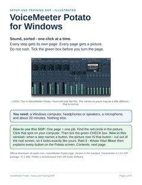</a><br><sub><b>1</b> · Cover</sub></td><td align="center" valign="top" width="25%"><a href="images/page-previews/page-02.png">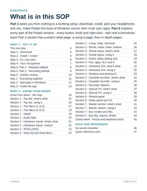</a><br><sub><b>2</b> · Contents</sub></td></tr>
</table>
</details>

<details>
<summary><b>Part 1 - Set it up</b> (pages 3-13)</summary>
<br>

<table>
<tr><td align="center" valign="top" width="25%"><a href="images/page-previews/page-03.png">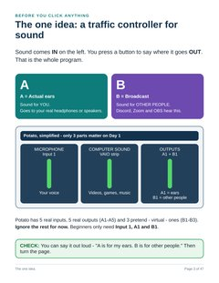</a><br><sub><b>3</b> · The one idea</sub></td><td align="center" valign="top" width="25%"><a href="images/page-previews/page-04.png">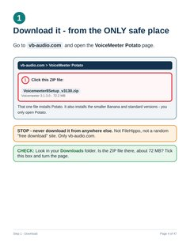</a><br><sub><b>4</b> · Step 1 - Download</sub></td><td align="center" valign="top" width="25%"><a href="images/page-previews/page-05.png">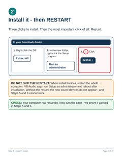</a><br><sub><b>5</b> · Step 2 - Install + restart</sub></td><td align="center" valign="top" width="25%"><a href="images/page-previews/page-06.png">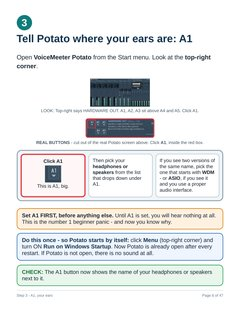</a><br><sub><b>6</b> · Step 3 - A1, your ears</sub></td></tr>
<tr><td align="center" valign="top" width="25%"><a href="images/page-previews/page-07.png">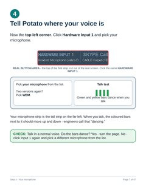</a><br><sub><b>7</b> · Step 4 - Your microphone</sub></td><td align="center" valign="top" width="25%"><a href="images/page-previews/page-08.png">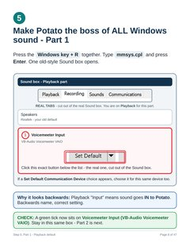</a><br><sub><b>8</b> · Step 5, Part 1 - Playback default</sub></td><td align="center" valign="top" width="25%"><a href="images/page-previews/page-09.png">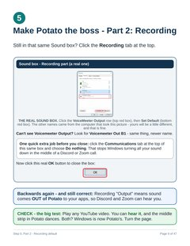</a><br><sub><b>9</b> · Step 5, Part 2 - Recording default</sub></td><td align="center" valign="top" width="25%"><a href="images/page-previews/page-10.png">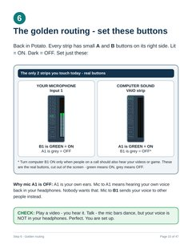</a><br><sub><b>10</b> · Step 6 - Golden routing</sub></td></tr>
<tr><td align="center" valign="top" width="25%"><a href="images/page-previews/page-11.png">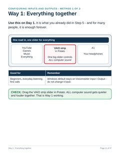</a><br><sub><b>11</b> · Way 1 - Everything together</sub></td><td align="center" valign="top" width="25%"><a href="images/page-previews/page-12.png">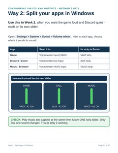</a><br><sub><b>12</b> · Way 2 - Split apps in Windows</sub></td><td align="center" valign="top" width="25%"><a href="images/page-previews/page-13.png">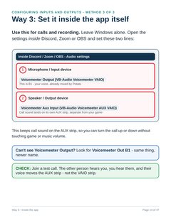</a><br><sub><b>13</b> · Way 3 - Inside the app</sub></td></tr>
</table>
</details>

<details>
<summary><b>Part 2 - Mixer map</b> (page 14)</summary>
<br>

<table>
<tr><td align="center" valign="top" width="25%"><a href="images/page-previews/page-14.png">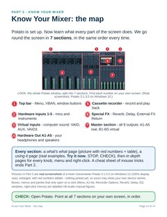</a><br><sub><b>14</b> · Know Your Mixer - the map</sub></td></tr>
</table>
</details>

<details>
<summary><b>Part 2 - Section 1 - Top bar and Menu</b> (pages 15-20)</summary>
<br>

<table>
<tr><td align="center" valign="top" width="25%"><a href="images/page-previews/page-15.png">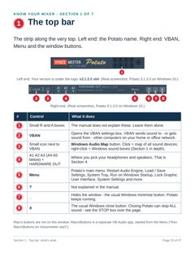</a><br><sub><b>15</b> · Section 1 - Top bar: what's what</sub></td><td align="center" valign="top" width="25%"><a href="images/page-previews/page-16.png">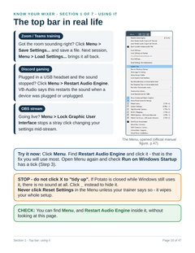</a><br><sub><b>16</b> · Section 1 - Top bar: using it</sub></td><td align="center" valign="top" width="25%"><a href="images/page-previews/page-17.png">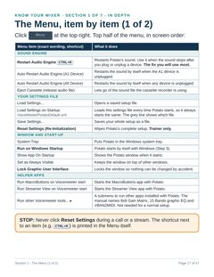</a><br><sub><b>17</b> · Section 1 - The Menu (1 of 2)</sub></td><td align="center" valign="top" width="25%"><a href="images/page-previews/page-18.png">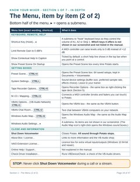</a><br><sub><b>18</b> · Section 1 - The Menu (2 of 2)</sub></td></tr>
<tr><td align="center" valign="top" width="25%"><a href="images/page-previews/page-19.png">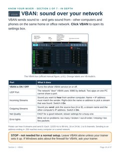</a><br><sub><b>19</b> · Section 1 - VBAN</sub></td><td align="center" valign="top" width="25%"><a href="images/page-previews/page-20.png">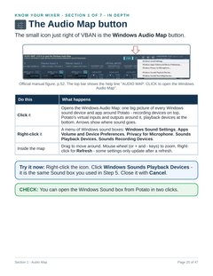</a><br><sub><b>20</b> · Section 1 - Audio Map</sub></td></tr>
</table>
</details>

<details>
<summary><b>Part 2 - Section 2 - Hardware inputs</b> (pages 21-26)</summary>
<br>

<table>
<tr><td align="center" valign="top" width="25%"><a href="images/page-previews/page-21.png">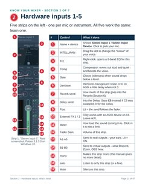</a><br><sub><b>21</b> · Section 2 - Hardware inputs: what's what</sub></td><td align="center" valign="top" width="25%"><a href="images/page-previews/page-22.png">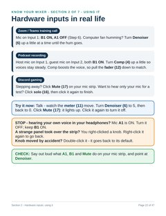</a><br><sub><b>22</b> · Section 2 - Hardware inputs: using it</sub></td><td align="center" valign="top" width="25%"><a href="images/page-previews/page-23.png">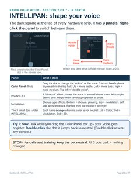</a><br><sub><b>23</b> · Section 2 - INTELLIPAN</sub></td><td align="center" valign="top" width="25%"><a href="images/page-previews/page-24.png">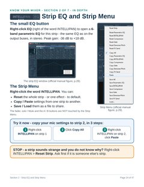</a><br><sub><b>24</b> · Section 2 - Strip EQ and Strip Menu</sub></td></tr>
<tr><td align="center" valign="top" width="25%"><a href="images/page-previews/page-25.png">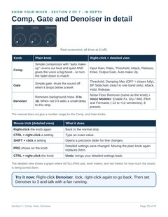</a><br><sub><b>25</b> · Section 2 - Comp, Gate, Denoiser</sub></td><td align="center" valign="top" width="25%"><a href="images/page-previews/page-26.png">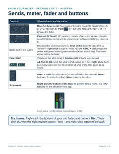</a><br><sub><b>26</b> · Section 2 - Sends, meter, fader, buttons</sub></td></tr>
</table>
</details>

<details>
<summary><b>Part 2 - Section 3 - Virtual inputs</b> (pages 27-30)</summary>
<br>

<table>
<tr><td align="center" valign="top" width="25%"><a href="images/page-previews/page-27.png">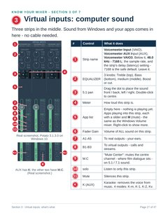</a><br><sub><b>27</b> · Section 3 - Virtual inputs: what's what</sub></td><td align="center" valign="top" width="25%"><a href="images/page-previews/page-28.png">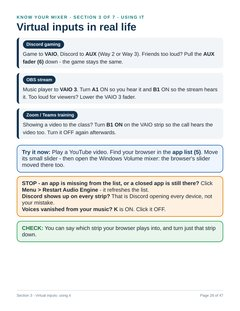</a><br><sub><b>28</b> · Section 3 - Virtual inputs: using it</sub></td><td align="center" valign="top" width="25%"><a href="images/page-previews/page-29.png">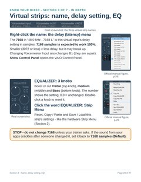</a><br><sub><b>29</b> · Section 3 - Name, delay setting, EQ</sub></td><td align="center" valign="top" width="25%"><a href="images/page-previews/page-30.png">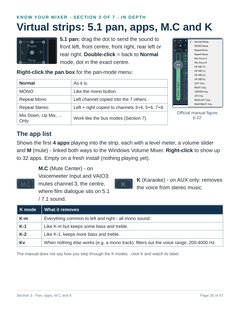</a><br><sub><b>30</b> · Section 3 - Pan, apps, M.C and K</sub></td></tr>
</table>
</details>

<details>
<summary><b>Part 2 - Section 4 - Hardware Out A1-A5</b> (pages 31-33)</summary>
<br>

<table>
<tr><td align="center" valign="top" width="25%"><a href="images/page-previews/page-31.png">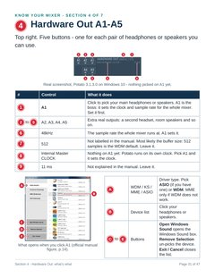</a><br><sub><b>31</b> · Section 4 - Hardware Out: what's what</sub></td><td align="center" valign="top" width="25%"><a href="images/page-previews/page-32.png">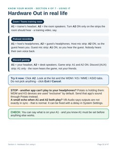</a><br><sub><b>32</b> · Section 4 - Hardware Out: using it</sub></td><td align="center" valign="top" width="25%"><a href="images/page-previews/page-33.png">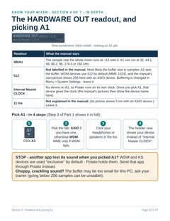</a><br><sub><b>33</b> · Section 4 - Readout and picking A1</sub></td></tr>
</table>
</details>

<details>
<summary><b>Part 2 - Section 5 - Cassette recorder</b> (pages 34-36)</summary>
<br>

<table>
<tr><td align="center" valign="top" width="25%"><a href="images/page-previews/page-34.png">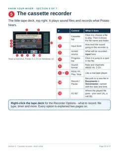</a><br><sub><b>34</b> · Section 5 - Cassette recorder: what's what</sub></td><td align="center" valign="top" width="25%"><a href="images/page-previews/page-35.png">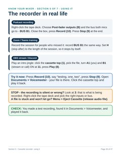</a><br><sub><b>35</b> · Section 5 - Cassette recorder: using it</sub></td><td align="center" valign="top" width="25%"><a href="images/page-previews/page-36.png">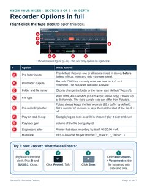</a><br><sub><b>36</b> · Section 5 - Recorder Options</sub></td></tr>
</table>
</details>

<details>
<summary><b>Part 2 - Section 6 - Special FX</b> (pages 37-40)</summary>
<br>

<table>
<tr><td align="center" valign="top" width="25%"><a href="images/page-previews/page-37.png">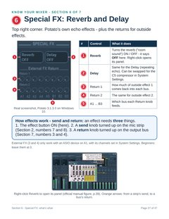</a><br><sub><b>37</b> · Section 6 - Special FX: what's what</sub></td><td align="center" valign="top" width="25%"><a href="images/page-previews/page-38.png">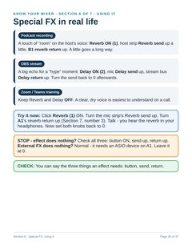</a><br><sub><b>38</b> · Section 6 - Special FX: using it</sub></td><td align="center" valign="top" width="25%"><a href="images/page-previews/page-39.png">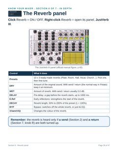</a><br><sub><b>39</b> · Section 6 - Reverb panel</sub></td><td align="center" valign="top" width="25%"><a href="images/page-previews/page-40.png">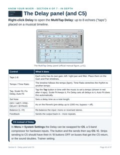</a><br><sub><b>40</b> · Section 6 - Delay panel and C5</sub></td></tr>
</table>
</details>

<details>
<summary><b>Part 2 - Section 7 - Master section</b> (pages 41-44)</summary>
<br>

<table>
<tr><td align="center" valign="top" width="25%"><a href="images/page-previews/page-41.png">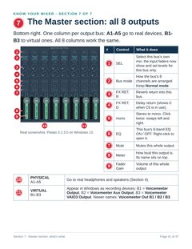</a><br><sub><b>41</b> · Section 7 - Master section: what's what</sub></td><td align="center" valign="top" width="25%"><a href="images/page-previews/page-42.png">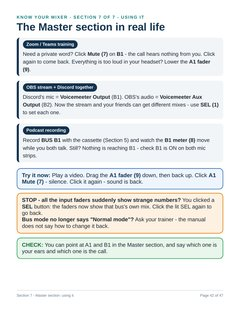</a><br><sub><b>42</b> · Section 7 - Master section: using it</sub></td><td align="center" valign="top" width="25%"><a href="images/page-previews/page-43.png">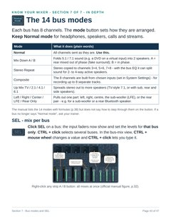</a><br><sub><b>43</b> · Section 7 - Bus modes and SEL</sub></td><td align="center" valign="top" width="25%"><a href="images/page-previews/page-44.png">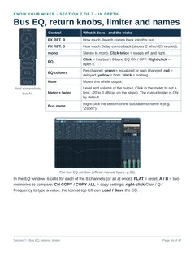</a><br><sub><b>44</b> · Section 7 - Bus EQ, returns, limiter</sub></td></tr>
</table>
</details>

<details>
<summary><b>Part 2 - Cheat sheet</b> (page 45)</summary>
<br>

<table>
<tr><td align="center" valign="top" width="25%"><a href="images/page-previews/page-45.png">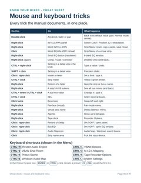</a><br><sub><b>45</b> · Cheat sheet - mouse and keyboard tricks</sub></td></tr>
</table>
</details>

<details>
<summary><b>Help and reference</b> (pages 46-47)</summary>
<br>

<table>
<tr><td align="center" valign="top" width="25%"><a href="images/page-previews/page-46.png">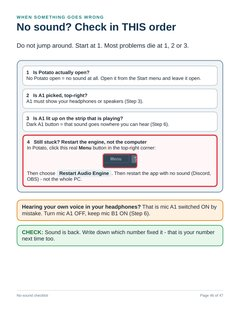</a><br><sub><b>46</b> · No-sound checklist</sub></td><td align="center" valign="top" width="25%"><a href="images/page-previews/page-47.png">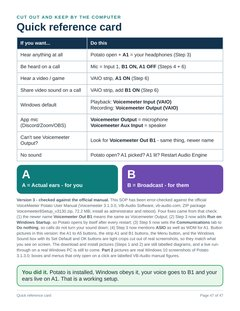</a><br><sub><b>47</b> · Quick reference card</sub></td></tr>
</table>
</details>

## 📖 The flipbook

[`index.html`](index.html) is a page-turner for the whole SOP: single page or two-page spread,
big ⬅️ ➡️ arrows beside the page, Prev / Next buttons, ← → keys, swipe on phones, click the page edges, a contents sidebar with
thumbnails, a jump-to-page menu, zoom, light / dark mode and a Download PDF button.
Deep links work: `https://juniorduc44.github.io/voicemeeter-potato-tutorial/#page=14` opens the mixer map; add `?view=spread` for the two-page view.

It is a plain static page (no build step) that shows the page pictures in `images/page-previews/`.
It goes live at **https://juniorduc44.github.io/voicemeeter-potato-tutorial/** once GitHub Pages is turned on for this repo
(Settings → Pages → *Deploy from a branch* → `main` / `/ (root)`). To try it locally:
`python3 -m http.server` in the repo folder, then open <http://localhost:8000/>.

<!-- README-NAV:END -->

## ℹ️ About this project

Training material for teaching **VoiceMeeter Potato** on Windows to complete beginners.

**Authoring standard (internal, "Easy-Standard"):** ridiculously easy, anyone can do it. That means a screenshot
for every direction — and when a step names a specific button, the picture in the
tutorial *is* that button, cropped from a screenshot of the real screen, so what
trainees see in print matches exactly what they see on their PC.

## What the training covers

1. Download VoiceMeeter Potato from the only official source (vb-audio.com) and
   install it as administrator, then restart Windows.
2. Set A1 (headphones/speakers) first, then the microphone on Hardware Input 1.
3. Make VoiceMeeter the Windows default input and output
   (Win+R → `mmsys.cpl` → Playback: **Voicemeeter Input (VB-Audio Voicemeeter VAIO)**;
   Recording: **Voicemeeter Output (VB-Audio Voicemeeter VAIO)**).
4. The beginner's golden routing — mic: **B1 on / A1 off**; computer sound: **A1 on**.
   (A = Actual ears, for you. B = Broadcast, for other people.)
5. The three ways to configure inputs/outputs, in teaching order:
   everything together (Windows default), split apps per-app in the Windows
   Volume mixer (VAIO / Aux / VAIO3), and setting devices inside an app
   (Discord / Zoom / OBS).
6. **Part 2 — Know Your Mixer** (pages 14–45): a section-by-section tour of the whole
   Potato window, in screen order — (1) top bar, (2) hardware inputs 1–5, (3) virtual
   inputs VAIO / AUX / VAIO3, (4) Hardware Out A1–A5, (5) cassette recorder,
   (6) Special FX + External FX Return, (7) Master section (A1–A5 physical,
   B1–B3 virtual). Each section: an annotated picture with numbered callouts, a
   "number / control / what it does" table, real-world examples (Discord gaming,
   Zoom/Teams training, OBS streaming, podcast recording), a *Try it now* exercise,
   a STOP box and a CHECK box — then "in depth" pages for every knob, menu and
   right-click (Menu item by item, VBAN, Audio Map, INTELLIPAN, strip EQ / Strip Menu,
   Comp / Gate / Denoiser, sends / meter / fader, virtual-strip latency / EQ / pan / M.C / K,
   HARDWARE OUT readout, Recorder Options, Reverb and Delay panels, the 14 bus modes, bus
   EQ / returns / limiter) and a mouse-and-keyboard cheat sheet. Every explanation is
   sourced from the official manual (see `source/OUTLINE.md`). 47 pages with a contents page.

## Repository layout

| Folder | Contents |
| --- | --- |
| `handout/` | `voicemeeter-potato-sop.pdf` — the printable SOP, built from `source/`. Earlier versions are kept as git tags (`v1`, `v2`, `v3`), not as files. |
| `docs/` | `ERROR_CHECK.md` — the v2 handout checked claim-by-claim against the official Potato 3.1.3.0 manual: what was verified, the four v3 fixes, and what still needs a real Windows PC. |
| `images/source-screenshots/` | Full original screenshots: the user's own Windows 10 VM captures of Potato 3.1.3.0 (two 100 % halves, the stitched full window, three 1.5x zoom captures) plus `SOURCES.md` (provenance, stitch method). |
| `images/button-crops/` | Tight crops of the very buttons the steps reference (A1, Set Default, OK, Menu, strip A1/B1 columns, …), plus the annotated Sound dialog. |
| `images/manual-figures/` | Official figures extracted unchanged from the VB-Audio *Voicemeeter Potato 3.1.3.0* user manual, plus `SOURCES.md` (manual page + figure for each, and what each crop is cut from). |
| `images/section-crops/` | The numbered "Know Your Mixer" crops (overview map + one or two per section), cut from the real captures (manual figures only for things not on the closed window). |
| `images/control-crops/` | Zoomed crops of single named controls used in the Part 2 in-depth pages (Menu, VBAN, Audio Map icon, Record, Stop, SEL, bus mode, …). |
| `images/page-previews/` | A PNG render of every handout page (current version, 150 dpi) — what the flipbook and the README links show. |
| `images/page-thumbs/` | Small JPEG thumbnails of every page for the README gallery and the flipbook sidebar. |
| `index.html`, `flipbook/` | The interactive flipbook (static page; `flipbook/pages.js` holds page numbers + titles). `.nojekyll` tells GitHub Pages to serve it as is. |
| `tools/` | `stitch_window.py` (pixel-exact stitch of the two 100 % captures), `make_section_crops.py` (cuts + numbers the section crops; every crop box and callout position lives here), `make_button_crops.py` (control crops), `paginate.py` (page footers + contents), `make_flipbook.py` (thumbnails + flipbook page list), `make_readme_nav.py` (README navigation and gallery) and `build_pdf.sh` (runs paginate, renders the PDF with headless Chrome, refreshes previews, thumbnails, flipbook data and README navigation). |
| `source/` | The single working build source: `index.html` (the handout) and `OUTLINE.md` (claim-by-claim outline with sources and edit log). Started from v3. Part 2 pictures are linked from `../images/section-crops/` (Part 1 pictures are still embedded). |

## Building

```
python3 tools/stitch_window.py        # only if the source captures changed
python3 tools/make_section_crops.py   # only if crops or callouts changed
python3 tools/make_button_crops.py    # only if control crops changed
./tools/build_pdf.sh                  # footers/contents + PDF + previews + flipbook + README nav
```

## Status / known limitations

- **Error-checked 2026-11-04** against the official Voicemeeter Potato 3.1.3.0
  user manual — see `docs/ERROR_CHECK.md` (four fixes landed in v3).
  **Not yet trainee-tested, and never run live on a real Windows PC** — that
  run-through is still the next step before using this with a real class.
- The VoiceMeeter Potato pictures and the Windows Sound dialog are real
  screenshots. Steps 1–2 (download ZIP, Extract All / Run as administrator /
  Install) are still labelled diagrams — no trustworthy real screenshot of the
  installer / right-click menu has been sourced yet. Swapping those in from a
  real Windows PC run-through is the gold version.
- `images/button-crops/btn-input1-header.png` is a little soft: its only real
  source is a 900px-wide screenshot. A larger original would improve it.

- **Part 2 pictures are real screenshots** of the user's own Windows 10 VM (Potato
  3.1.3.0 x64, 100 % scaling, fresh install, nothing picked yet). Boxes, menus and panels
  that only open on a click (Menu, A1 device list, Recorder Options, Reverb / Delay panels,
  EQ windows, right-click menus, VBAN, Audio Map menu) are still official VB-Audio manual
  figures, labelled as such. The zoom captures are a 1.5x scaled view, so they are smoother
  but carry no extra detail. Manual gaps (stated as such on the pages) are listed in
  `source/OUTLINE.md`.

See `CHANGELOG.md` for what changed between versions.
