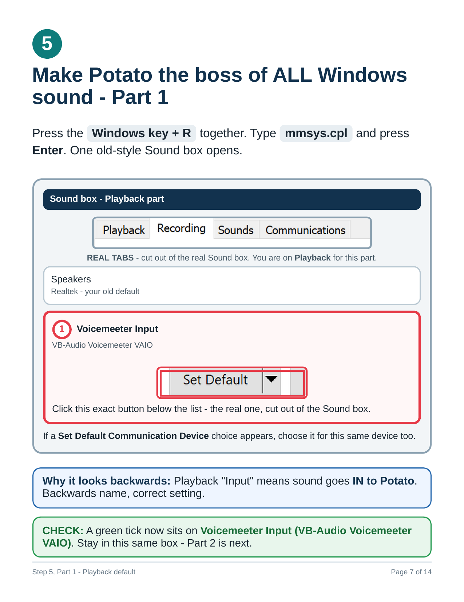

<!-- generated by tools/make_flipbook.py - do not edit -->

<a href="../../README.md">🏠 Home</a> &nbsp;·&nbsp; <a href="page-01.md">Cover</a> &nbsp;·&nbsp; <a href="page-02.md">Contents</a> &nbsp;·&nbsp; <a href="../../handout/voicemeeter-potato-sop.pdf">⬇️ PDF</a>

<h3 align="center">Page 7 of 47 · Step 4 - Your microphone</h3>

<table align="center"><tr>
<td valign="middle" align="center"></td>
<td align="center"></td>
<td valign="middle" align="center"></td>
</tr></table>

<a href="page-06.md">⬅️ 6 · Step 3 - A1, your ears</a> &nbsp;&nbsp;|&nbsp;&nbsp; <a href="page-08.md">Step 5, Part 1 - Playback default · 8 ➡️</a>

Click the big arrows to turn the page. Click the page to see it full size.

