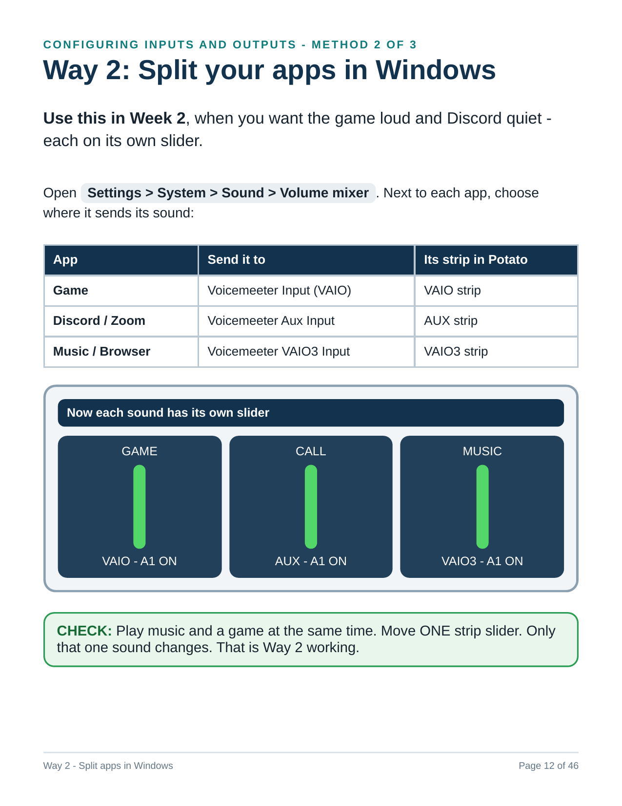

<!-- generated by tools/make_flipbook.py - do not edit -->

<a href="../../README.md">🏠 Home</a> &nbsp;·&nbsp; <a href="page-01.md">Cover</a> &nbsp;·&nbsp; <a href="page-02.md">Contents</a> &nbsp;·&nbsp; <a href="../../handout/voicemeeter-potato-sop.pdf">⬇️ PDF</a>

<h3 align="center">Page 12 of 47 · Way 2 - Split apps in Windows</h3>

<table align="center"><tr>
<td valign="middle" align="center"></td>
<td align="center"></td>
<td valign="middle" align="center"></td>
</tr></table>

<a href="page-11.md">⬅️ 11 · Way 1 - Everything together</a> &nbsp;&nbsp;|&nbsp;&nbsp; <a href="page-13.md">Way 3 - Inside the app · 13 ➡️</a>

Click the big arrows to turn the page. Click the page to see it full size.

