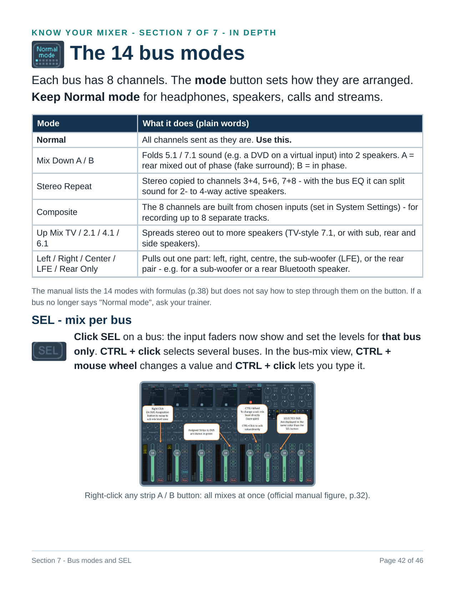

<!-- generated by tools/make_flipbook.py - do not edit -->

<a href="../../README.md">🏠 Home</a> &nbsp;·&nbsp; <a href="page-01.md">Cover</a> &nbsp;·&nbsp; <a href="page-02.md">Contents</a> &nbsp;·&nbsp; <a href="../../handout/voicemeeter-potato-sop.pdf">⬇️ PDF</a>

<h3 align="center">Page 42 of 47 · Section 7 - Master section: using it</h3>

<table align="center"><tr>
<td valign="middle" align="center"></td>
<td align="center"></td>
<td valign="middle" align="center"></td>
</tr></table>

<a href="page-41.md">⬅️ 41 · Section 7 - Master section: what's what</a> &nbsp;&nbsp;|&nbsp;&nbsp; <a href="page-43.md">Section 7 - Bus modes and SEL · 43 ➡️</a>

Click the big arrows to turn the page. Click the page to see it full size.

